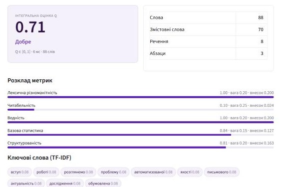
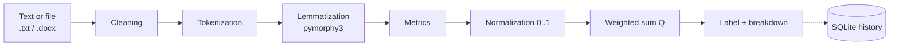

# МАЛІ: Ukrainian Text Quality Analyzer

**МАЛІ** (*Метричний Аналіз Лексики та Інформативності*, "Metric Analysis of Vocabulary and Informativeness") is a rule-based NLP system that scores the quality of Ukrainian texts. It combines five interpretable metrics into one integral score **Q ∈ [0, 1]** and explains what pulled the score up or down. Everything runs in a Streamlit web app.


<p align="center">
  
</p>

## Why

Most readability and "water" checkers are built for English. Ukrainian is highly inflected: one word such as *аналітичний* ("analytical") appears in a text as *аналітичну*, *аналітичних*, *аналітичною* and so on. МАЛІ handles this with lemmatization and ships its own curated dictionaries of quality markers, filler words, slang and spam.

## How the score works

```
Q = Σ (metric_score × weight),   Σ weight = 1
```

| Metric | Weight | What it measures |
|---|---|---|
| Lexical diversity | 0.20 | Type-token ratio, MATTR, share of hapax legomena |
| Readability | 0.25 | Coleman-Liau index and a Flesch-style score adapted to Ukrainian syllables |
| Water content | 0.20 | Share of filler words, noise, slang and spam; penalty for profanity; bonus for high-quality vocabulary |
| Basic statistics | 0.15 | Average word, sentence and paragraph length |
| Structure | 0.20 | Introduction and conclusion markers, number and balance of paragraphs |

TF-IDF is calculated as well and shown as key words. It does not affect Q.

| Q | Label |
|---|---|
| ≥ 0.80 | Відмінно (excellent) |
| ≥ 0.60 | Добре (good) |
| ≥ 0.40 | Задовільно (satisfactory) |
| < 0.40 | Незадовільно (poor) |

You can change the weights and thresholds in [`text-quality-system/config.py`](text-quality-system/config.py) or on the **Налаштування** tab of the app.

### Pipeline



## Dictionaries

The dictionaries live in [`dictionary/`](dictionary/) and hold **5,028 unique lemmas** (plus 1,983 stop words). Each lemma belongs to exactly one category. No word is both "good" and "bad". The test suite checks both rules.

| Good vocabulary (raises Q) | Lemmas | Weight |
|---|---|---|
| `academic`: scientific terminology | 753 | 3.0 |
| `professional`: business, law, technology | 597 | 2.5 |
| `analytical`: reasoning, comparison, evaluation | 464 | 2.0 |
| `literary`: expressive and high-style vocabulary, culture, society | 642 | 2.0 |
| `quality_general`: clear and literate speech | 375 | 1.5 |
| `constructive`: collaboration, development, ethics | 407 | 1.0 |
| **Total** | **3,238** | |

| Bad vocabulary (lowers Q) | Lemmas | Matching |
|---|---|---|
| `slang`: slang, jargon, mild swearing | 1,457 | by lemma |
| `noise`: interjections, "ааа", "бла-бла" | 88 | exact form |
| `profanity`: obscene words (strong penalty) | 86 | by lemma |
| `filler`: filler words such as "типу", "короче", "ну типу" | 67 | exact form |
| `spam`: advertising and click-bait | 61 | by lemma (imperatives exact) |
| `repetition`: stretched words such as "ахахах", "нууу" | 31 | exact form |
| **Total** | **1,790** | |

### Matching rules

- **By lemma.** The dictionary stores the base form. The text is lemmatized with [pymorphy3](https://github.com/no-plagiarism/pymorphy3) and its Ukrainian dictionary, so *науковці*, *експериментальної* and *аналітичну* all match.
- **Exact form** for filler words and noise. A lemmatizer would turn the filler *типу* ("like") into *тип* ("type") and *короче* ("so, anyway") into *короткий* ("short"), and every scientific text would get penalized.
- **Imperatives always match exactly.** *Поділись!* ("Share!") is spam. *Компанія поділилася результатами* ("The company shared its results") is not.
- **Phrases** such as *ну типу* or *тільки сьогодні* are matched as n-grams and counted once.

### Sources

- The core dictionaries were compiled by hand.
- About 1,250 slang lemmas come from the **VESUM** morphological dictionary of Ukrainian. These are words that VESUM tags `Slng` and that have no neutral meaning. They were taken through the [`pymorphy3-dicts-uk`](https://pypi.org/project/pymorphy3-dicts-uk/) package, which is distributed under GPLv3. Standard loanwords that VESUM also marks as slang (*софт*, *фішинг*, *маркетплейс* and others) were excluded by hand.

## Example results

These are the bundled sample texts from [`tests/sample_texts`](text-quality-system/tests/sample_texts):

| Text | Genre | Q | Label |
|---|---|---|---|
| `художні_1_осінь` | fiction | 0.82 | Відмінно |
| `художні_2_дорога` | fiction | 0.79 | Добре |
| `наукові_2_методи` | scientific | 0.74 | Добре |
| `наукові_1_алгоритм` | scientific | 0.73 | Добре |
| `good_article` | article | 0.69 | Добре |
| `публіцистичні_2_аналітика` | analytical journalism | 0.69 | Добре |
| `публіцистичні_1_новина` | news | 0.65 | Добре |
| `низькоякісний_1_допис` | low-quality post | 0.53 | Задовільно |
| `bad_article` | filler-heavy text | 0.40 | Задовільно |
| `низькоякісний_2_спам` | spam | 0.27 | Незадовільно |

## Quick start

```bash
git clone https://github.com/maliboo-wow/MALI-text-quality-system.git
cd MALI-text-quality-system/text-quality-system

python -m venv .venv
# Windows: .venv\Scripts\activate    macOS/Linux: source .venv/bin/activate
pip install -r requirements.txt

streamlit run app.py
```

The app opens at `http://localhost:8501`. You can paste text, upload a `.txt` or `.docx` file, or try the demo text. Results can be saved to a local SQLite history, which is created automatically.

### Use it from Python

```python
from analysis.pipeline import analyze_text

result = analyze_text(open("tests/sample_texts/наукові_1_алгоритм.txt", encoding="utf-8").read())
print(result["Q"], result["label"])              # 0.7277 Добре
print(result["metrics"]["water_content"]["raw"]["found_words"])
```

### Tests

```bash
cd text-quality-system
python -m pytest
```

## Project structure

```
├── dictionary/
│   ├── good_words.py          # quality vocabulary, 6 weighted categories
│   ├── bad_words.py           # filler, noise, slang, spam, profanity
│   └── stop_words.py          # Ukrainian stop words
├── docs/                      # images for this README
└── text-quality-system/
    ├── app.py                 # Streamlit interface
    ├── config.py              # weights, thresholds, metric parameters
    ├── analysis/              # pipeline, normalization, Q calculation
    ├── metrics/               # one module per metric
    ├── preprocessing/
    │   ├── cleaner.py         # HTML, URL and whitespace cleanup
    │   ├── tokenizer.py       # words, sentences, paragraphs, syllables
    │   ├── lemmatizer.py      # pymorphy3 lemmatization with caching
    │   ├── dictionary_index.py# lemma, exact-form and phrase matching
    │   └── file_loader.py     # .txt / .docx loading
    ├── database/              # SQLite history of analyses
    └── tests/                 # pytest suite + sample texts
```

## Limitations and ideas

- The system is rule-based and the weights are set by hand. A natural next step is to calibrate them against texts rated by people.
- Homonyms remain a problem. For example, *типу* is both a filler word and the genitive of *тип*. Exact matching keeps false positives low but cannot remove them entirely.
- Readability formulas such as Coleman-Liau were designed for English and are applied here as approximations.

---

My first NLP project, built by [maliboo-wow](https://github.com/maliboo-wow).
